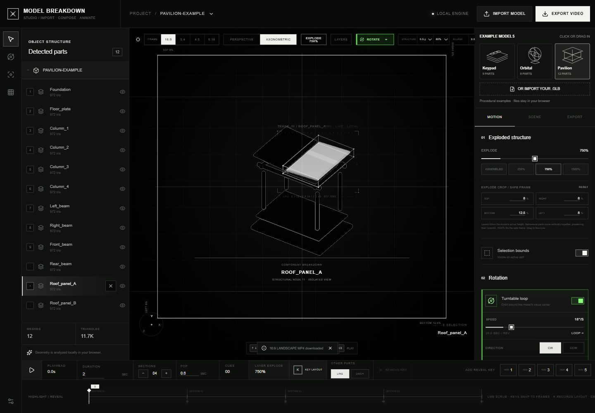

# Model Breakdown Studio

**Import a 3D model, explain its components, and compose a presentation animation.**

A browser tool by Muwen Li, developed with Codex. The original web app is named **MESHROOM**.

**[Read the product case](docs/product-case.md)** — the production problem, interaction decisions, automation boundaries and delivery criteria.

## [▶ Open the interactive web app](https://meshroom-breakdown-studio.limuwen9.chatgpt.site)

Opens the original MESHROOM app in a separate browser page. **Public access · No sign-in required · Built-in demo model.** The interactive controls are in the linked app.

[All projects](https://github.com/MuwenTriLi/creative-workflows#selected-work) · [Workflow](docs/workflow.md) · [Model preparation](docs/model-preparation.md) · [Screen recording](showcase/recordings/) · [Walkthrough notes](showcase/walkthrough.md)

## Try it in one minute

1. Open the web app. A nine-part keypad model is ready to explore; no file is needed.
2. Choose **250%** or **750%** under **Exploded structure**, then select a named part in the left panel to inspect it.
3. Toggle **ROTATE**, change its speed, or switch back to **ASSEMBLED** to compare the structure. To try your own model, choose **IMPORT MODEL**; a `.glb` with separate, named meshes works best.

<a href="https://meshroom-breakdown-studio.limuwen9.chatgpt.site"></a>

*Original app, shown with a selected component. Click the image or the link above to interact.*

## What the tool is for

Turn a model's component structure into a visual explanation: inspect named parts, separate them spatially, highlight what matters, and compose motion for a presentation.

| Step | What the creator does |
| --- | --- |
| Import | Bring a model into the browser and check its orientation and component list. |
| Compose | Adjust the exploded view, select parts, and control emphasis. |
| Animate | Arrange motion and reveal cues on the timeline. |
| Present | Preview the sequence and export an animation or still. |

## Design contribution

The interface brings **model structure, spatial composition and motion timing** into one working view. The left panel identifies parts, the central viewport shows the result, and the right controls and timeline let the creator refine how the model is explained.

My contribution is the creative direction and interaction workflow, developed with Codex-assisted implementation. The reusable method is **inspect → compose → emphasize → animate → review**; the [workflow notes](docs/workflow.md) explain it step by step.

This is a **browser tool and reusable creative workflow**. An installable agent Skill is not currently included.

## Recorded walkthrough

**Screen recording pending.** A short walkthrough and selected frames will be added here after Muwen supplies the material.

The planned recording follows one task from model import through one useful adjustment to the final animation. Recording files belong in [showcase/recordings/](showcase/recordings/); stills and GIFs belong in [showcase/images/](showcase/images/). The [walkthrough outline](showcase/walkthrough.md) leaves space for the model, intended effect and key steps.

<details>
<summary>Static preview of the local adaptation</summary>

The image below is a screenshot, not an embedded application. It shows the local adaptation with its additional sample shelf. Use **Open the interactive web app** above to visit the original MESHROOM interface.

[](https://meshroom-breakdown-studio.limuwen9.chatgpt.site)

</details>

## Project files

| Location | Contents |
| --- | --- |
| [showcase/](showcase/) | Screen recording, selected visuals and walkthrough notes. |
| [docs/](docs/) | Workflow, model preparation and implementation notes. |
| [app/](app/) | Preserved local adaptation of the browser app. |
| [public/](public/) | Procedural examples and a location for approved sample GLBs. |
| [tests/](tests/) | Geometry and sample integrity checks. |

<details>
<summary>Run the separate local adaptation</summary>

The source in this repository is the previously prepared local adaptation. It is separate from the linked original web app; it has not replaced or redeployed that app.

Node.js 22.13+ and pnpm are required.

```sh
pnpm install --frozen-lockfile
pnpm dev
```

Open the Local URL printed in the terminal. If needed, choose another port with `pnpm dev --port 4186`.

```sh
pnpm test
pnpm build
pnpm preview --port 4186
```

The local adaptation has three procedural samples. Its production build and 17 geometry/sample tests passed. Sample GLB import, orientation, explode/highlight and a two-second 720p H.264 export were checked locally. These results do not constitute a fresh validation of the hosted original. OBJ/FBX, larger models and higher export resolutions have not been independently verified here.

</details>

This repository is a public portfolio presentation and source reference. No open-source license has been selected; dependency licenses remain with their respective owners.
