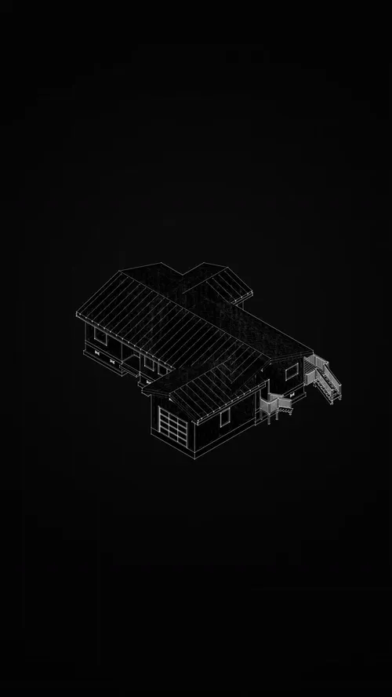
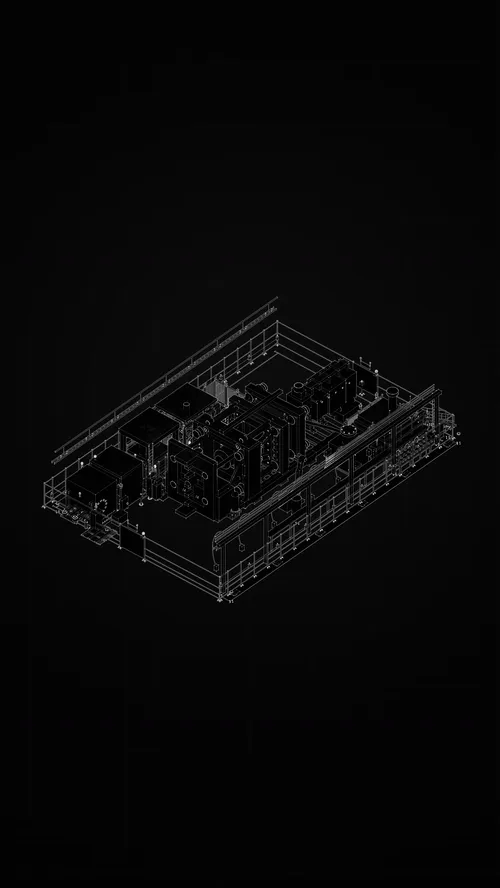
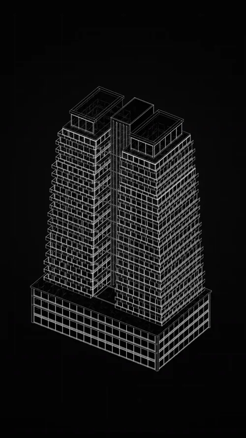
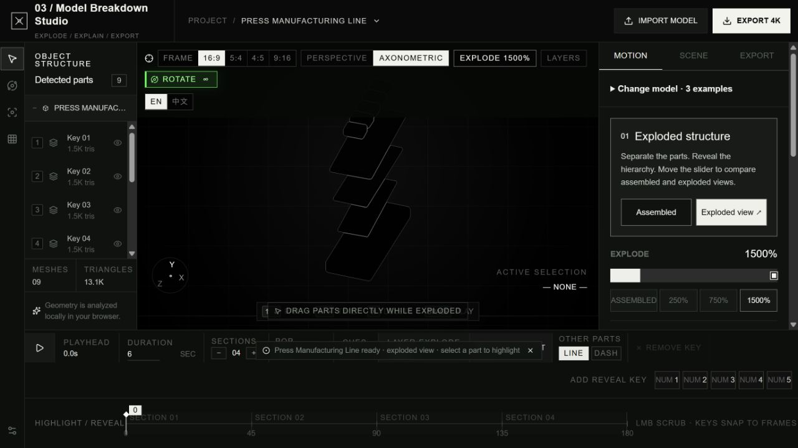

# Model Breakdown Studio

**Turn a multi-part GLB into an exploded view, a focused detail and a presentation sequence.**

A browser tool by **Muwen Li**, developed with Codex. The public product name is **Model Breakdown Studio** across the app and portfolio. Designed for visual explanation in architecture, engineering, construction (AEC) and industrial design: help an audience see which parts matter and how they relate.

**[Open the interactive app →](https://meshroom-breakdown-studio.limuwen9.chatgpt.site)** · [Product case](docs/product-case.md) · [Selected output films](showcase/README.md) · [Source & MIT scope](#code-and-media-rights) · [All projects](https://github.com/MuwenTriLi/creative-workflows#selected-work)

## From a complete model to a readable explanation

<table><tr>
<td width="50%" align="center" valign="top"><a href="https://muwentrili.github.io/creative-workflows/films/?project=model&amp;film=structure"></a><br><b>Separate the systems</b><br><sub>Structural hierarchy.</sub><br><a href="https://muwentrili.github.io/creative-workflows/films/?project=model&amp;film=structure">Watch 11 s MP4</a></td>
<td width="50%" align="center" valign="top"><a href="https://muwentrili.github.io/creative-workflows/films/?project=model&amp;film=residence"></a><br><b>Explain a component in context</b><br><sub>Part-to-whole relationships.</sub><br><a href="https://muwentrili.github.io/creative-workflows/films/?project=model&amp;film=residence">Watch 9.5 s MP4</a></td>
</tr></table>

These animated previews retain the complete sequences at the source video’s 30 fps timing. Click a preview or its **Watch MP4** link for the complete film. Use **Open the interactive app** above to work with the controls.

### More applications: systems and envelope

<table><tr>
<td width="50%" align="center" valign="top"><a href="https://muwentrili.github.io/creative-workflows/films/?project=model&amp;film=systems"></a><br><b>Direct attention to a building system</b><br><sub>Selective system emphasis.</sub><br><a href="https://muwentrili.github.io/creative-workflows/films/?project=model&amp;film=systems">Watch 11.5 s MP4</a></td>
<td width="50%" align="center" valign="top"><a href="https://muwentrili.github.io/creative-workflows/films/?project=model&amp;film=tower"></a><br><b>Read the tower in layers</b><br><sub>Levels and envelope.</sub><br><a href="https://muwentrili.github.io/creative-workflows/films/?project=model&amp;film=tower">Watch 8 s MP4</a></td>
</tr></table>

All four supplied films are represented here. [Open the output gallery and four large detail stills →](showcase/README.md). These are final outputs supplied by Muwen; the input-to-export process recording is still to add.

## Try it in one minute

1. **Choose a model:** the app opens with **Press Manufacturing Line**, already exploded. Open **Change model · 3 examples** for **Wood House** and **Car Production Line**; no account or upload is required.
2. **Inspect:** use **Assembled** / **Exploded view** or the prominent **Exploded structure** slider, then select a named component in the left panel. Compare it with **ASSEMBLED**.
3. **Explain:** toggle **ROTATE**, adjust framing and choose the component the viewer should notice. Use the timeline to shape emphasis and motion.
4. **Review and export:** choose **EXPORT 4K**, review the aspect, duration and frame rate, then choose **RENDER**. Inspect the downloaded MP4. [Complete export guide](https://github.com/MuwenTriLi/creative-workflows/blob/main/docs/studio-delivery.md).
5. **Bring your model:** choose **IMPORT YOUR OWN GLB** or drop your file onto the canvas. Use separate, meaningfully named mesh parts, then confirm orientation. Your file is processed in the browser. Switching models asks before clearing the current part edits and timeline.

<a href="https://meshroom-breakdown-studio.limuwen9.chatgpt.site"></a>

*The linked app contains the controls. The repository is the case study and source reference.*

### Three real inputs to try

| Example | What to inspect | Preserved mesh parts |
| --- | --- | ---: |
| Wood House | Roof, walls, framing and foundation | 18 |
| Press Manufacturing Line | Moving assembly, dies, structure and equipment | 32 |
| Car Production Line | Structure, conveyor, vehicle body and robot systems | 30 |

The previews use the supplied model geometry. Lossless delivery compression preserves every GLB byte; model files and screenshots remain outside the MIT code license. [Verification and limits](docs/example-model-review.md).

## The production problem

A complete model can be visually dense even when its geometry is accurate. A presenter may need to isolate a structural system, show an assembly relationship or explain a detail; making a new animation setup for every explanation introduces repeated work.

The product hypothesis is that **hierarchy, exploded composition, highlighting and timing in one workspace** make that explanation easier to construct and revise. The supplied architectural films demonstrate output possibilities. Industrial-design use is an intended application, not a validated customer outcome. This is a presentation tool, not a BIM coordination or engineering verification system.

| Stage | The tool handles | The creator decides |
| --- | --- | --- |
| Import & inspect | Load geometry and expose available parts | Correct orientation, useful grouping and what needs explaining |
| Compose | Apply explode and view parameters | Spatial separation, framing and preserved context |
| Emphasize & animate | Apply selected highlight and timing controls | Focal component, sequence and readable pauses |
| Review & export | Generate the selected presentation output | Check clipping, continuity, labels and the encoded result |

**Local revision:** change the focal part, framing or explode amount without reimporting the model. Automatic semantic grouping, language-driven storytelling and revision rollback are not established capabilities. A fused mesh cannot automatically become a meaningful set of components.

## What this case demonstrates

My contribution is creative direction and the interaction workflow, developed with Codex-assisted implementation. Professional production experience informed the need for component selection, editable emphasis and a visible review step. The method is **inspect → compose → emphasize → animate → review**. [Full decisions, hypothesis and acceptance criteria](docs/product-case.md).

**Evidence now:** four architectural output films and four stills; a public interactive app; repository source; and two bounded technical checks: a synthetic three-part GLB and the real Press Manufacturing Line each exported a 2 s / 4K / 30 fps H.264 file. The real films were supplied after that test; they are not claimed as newly reproduced exports in this review.

**Next evidence:** a short recording connecting one real GLB to one output, including one local correction. The final visual output is present; the import-to-export process recording is still pending. [Recording outline](showcase/walkthrough.md) · [Model preparation](docs/model-preparation.md).

## Project files

| Location | Contents |
| --- | --- |
| [showcase/](showcase/) | Selected final films, detail frames, provenance and recording outline |
| [docs/](docs/) | Workflow, model preparation, implementation and product decisions |
| [app/](app/) | Preserved local adaptation; separate from the original hosted app |
| [public/](public/) | Procedural previews and a location for approved sample GLBs |
| [tests/](tests/) | Geometry and sample integrity checks |

<details>
<summary>Run the separate local adaptation</summary>

The source in this repository is the previously prepared local adaptation. It is separate from the linked original web app; it has not replaced or redeployed that app.

Node.js 22.13+ and pnpm are required.

```sh
pnpm install --frozen-lockfile
pnpm dev
```

Open the Local URL printed in the terminal. If needed, choose another port with `pnpm dev --port 4186`.

```sh
pnpm test
pnpm build
pnpm preview --port 4186
```

The local adaptation has three procedural samples. Its production build and 17 geometry/sample tests passed. Sample GLB import, orientation, explode/highlight and a two-second 720p H.264 export were checked locally. Separately, the original hosted app completed a three-part synthetic GLB import, orientation, explode/selection and a two-second 4K / 30 fps H.264 export (60 frames, full decode passed). This is a bounded technical check. The supplied Wood House (18 parts), Press Manufacturing Line (32 parts) and Car Production Line (30 parts) now load in the original app, with switching, explode and part selection checked. The current hosted Press Manufacturing Line also completed a two-second 4K / 30 fps H.264 export (60 decoded frames, full decode passed). Full-length exports from the other real inputs, OBJ/FBX and first-time creator success remain unverified. [Model-library check](docs/example-model-review.md). [Check details and limits](https://github.com/MuwenTriLi/creative-workflows/blob/main/docs/functional-review.md).

</details>


## Code and media rights

**Original application code in this repository is MIT licensed.** See [LICENSE](LICENSE) and [the exact scope](MEDIA-RIGHTS.md). The retained repository adaptation and the separate hosted original app are identified above; this repository's license does not relicense an external deployment.

**Showcase videos, renders, screenshots, imported models and brand/company materials are excluded from the code license.** They are displayed as portfolio evidence and retain their existing ownership. Dependencies retain their respective licenses. The illoca architecture-growth case is a separate company production presentation, with no public Skill or company source release.
