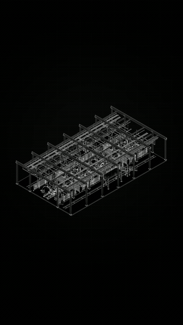
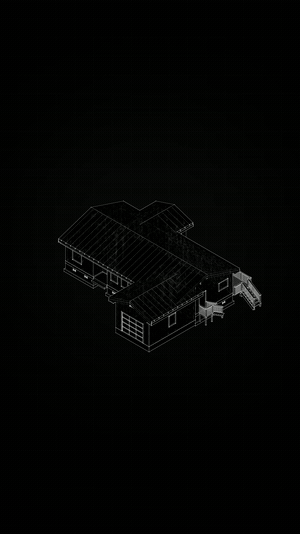

# Model Breakdown Studio

**Turn a multi-part GLB into an exploded view, a focused detail and a presentation sequence.**

A browser tool by **Muwen Li**, developed with Codex. The original live app is named **MESHROOM**. Designed for visual explanation in architecture, engineering, construction (AEC) and industrial design: help an audience see which parts matter and how they relate.

**[Open the interactive app →](https://meshroom-breakdown-studio.limuwen9.chatgpt.site)** · [Product case](docs/product-case.md) · [Selected output films](showcase/README.md) · [Source & MIT scope](#code-and-media-rights) · [All projects](https://github.com/MuwenTriLi/creative-workflows#selected-work)

## From a complete model to a readable explanation

<table><tr>
<td width="50%" align="center" valign="top"><a href="showcase/media/structure.mp4"></a><br><b>Separate the systems</b><br><sub>Keep the assembly visible while directing attention to its structural frame.</sub><br><a href="showcase/media/structure.mp4">Watch the 11 s output</a></td>
<td width="50%" align="center" valign="top"><a href="showcase/media/residence.mp4"></a><br><b>Explain a component in context</b><br><sub>Read the roof, floors and smaller elements as parts of one model.</sub><br><a href="showcase/media/residence.mp4">Watch the 9.5 s output</a></td>
</tr></table>

These final output films were supplied by Muwen. Use the interactive app link above to work with the controls. The GIFs are compact previews; the linked MP4s preserve the complete supplied sequences. [Four films and selected detail frames](showcase/README.md).

## Try it in one minute

1. **Open:** the original app includes a nine-part keypad model, so no upload is required to start.
2. **Inspect:** choose **250%** or **750%** in **Exploded structure**, then select a named component in the left panel. Compare it with **ASSEMBLED**.
3. **Explain:** toggle **ROTATE**, adjust framing and choose the component the viewer should notice. Use the timeline to shape emphasis and motion.
4. **Bring your model:** choose **IMPORT MODEL**. Use a `.glb` containing separate, meaningfully named meshes. Check orientation, scale and part names before composing.

<a href="https://meshroom-breakdown-studio.limuwen9.chatgpt.site"></a>

*The linked app contains the controls. The repository is the case study and source reference.*

## The production problem

A complete model can be visually dense even when its geometry is accurate. A presenter may need to isolate a structural system, show an assembly relationship or explain a detail; making a new animation setup for every explanation introduces repeated work.

The product hypothesis is that **hierarchy, exploded composition, highlighting and timing in one workspace** make that explanation easier to construct and revise. The supplied architectural films demonstrate output possibilities. Industrial-design use is an intended application, not a validated customer outcome. This is a presentation tool, not a BIM coordination or engineering verification system.

| Stage | The tool handles | The creator decides |
| --- | --- | --- |
| Import & inspect | Load geometry and expose available parts | Correct orientation, useful grouping and what needs explaining |
| Compose | Apply explode and view parameters | Spatial separation, framing and preserved context |
| Emphasize & animate | Apply selected highlight and timing controls | Focal component, sequence and readable pauses |
| Review & export | Generate the selected presentation output | Check clipping, continuity, labels and the encoded result |

**Local revision:** change the focal part, framing or explode amount without reimporting the model. Automatic semantic grouping, language-driven storytelling and revision rollback are not established capabilities. A fused mesh cannot automatically become a meaningful set of components.

## What this case demonstrates

My contribution is creative direction and the interaction workflow, developed with Codex-assisted implementation. Professional production experience informed the need for component selection, editable emphasis and a visible review step. The method is **inspect → compose → emphasize → animate → review**. [Full decisions, hypothesis and acceptance criteria](docs/product-case.md).

**Evidence now:** four architectural output films and four stills; a public interactive app; repository source; and a separate hosted technical check using a synthetic three-part GLB that exported a 2 s / 4K / 30 fps H.264 file. The real films were supplied after that test; they are not claimed as newly reproduced exports in this review.

**Next evidence:** a short recording connecting one real GLB to one output, including one local correction. The final visual output is present; the import-to-export process recording is still pending. [Recording outline](showcase/walkthrough.md) · [Model preparation](docs/model-preparation.md).

## Project files

| Location | Contents |
| --- | --- |
| [showcase/](showcase/) | Selected final films, detail frames, provenance and recording outline |
| [docs/](docs/) | Workflow, model preparation, implementation and product decisions |
| [app/](app/) | Preserved local adaptation; separate from the original hosted app |
| [public/](public/) | Procedural previews and a location for approved sample GLBs |
| [tests/](tests/) | Geometry and sample integrity checks |

<details>
<summary>Run the separate local adaptation</summary>

The source in this repository is the previously prepared local adaptation. It is separate from the linked original web app; it has not replaced or redeployed that app.

Node.js 22.13+ and pnpm are required.

```sh
pnpm install --frozen-lockfile
pnpm dev
```

Open the Local URL printed in the terminal. If needed, choose another port with `pnpm dev --port 4186`.

```sh
pnpm test
pnpm build
pnpm preview --port 4186
```

The local adaptation has three procedural samples. Its production build and 17 geometry/sample tests passed. Sample GLB import, orientation, explode/highlight and a two-second 720p H.264 export were checked locally. Separately, the original hosted app completed a three-part synthetic GLB import, orientation, explode/selection and a two-second 4K / 30 fps H.264 export (60 frames, full decode passed). This is a bounded technical check. Real-model storytelling, OBJ/FBX and larger inputs remain unverified. [Check details and limits](https://github.com/MuwenTriLi/creative-workflows/blob/main/docs/functional-review.md).

</details>


## Code and media rights

**Original application code in this repository is MIT licensed.** See [LICENSE](LICENSE) and [the exact scope](MEDIA-RIGHTS.md). The retained repository adaptation and the separate hosted original app are identified above; this repository's license does not relicense an external deployment.

**Showcase videos, renders, screenshots, imported models and brand/company materials are excluded from the code license.** They are displayed as portfolio evidence and retain their existing ownership. Dependencies retain their respective licenses. The illoca architecture-growth case is a separate company production presentation, with no public Skill or company source release.
