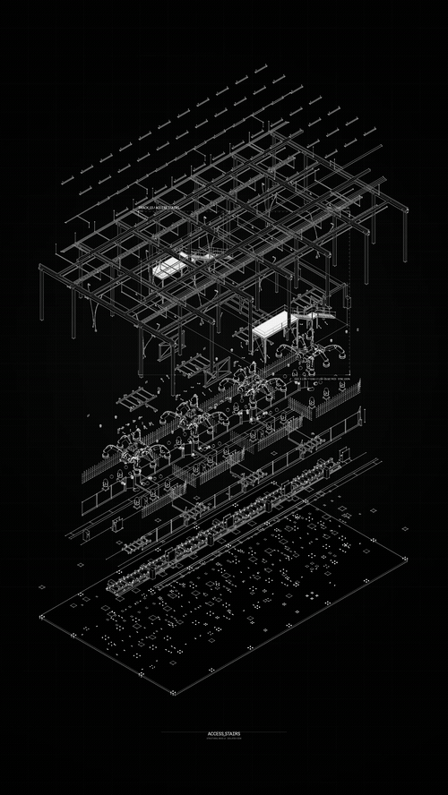
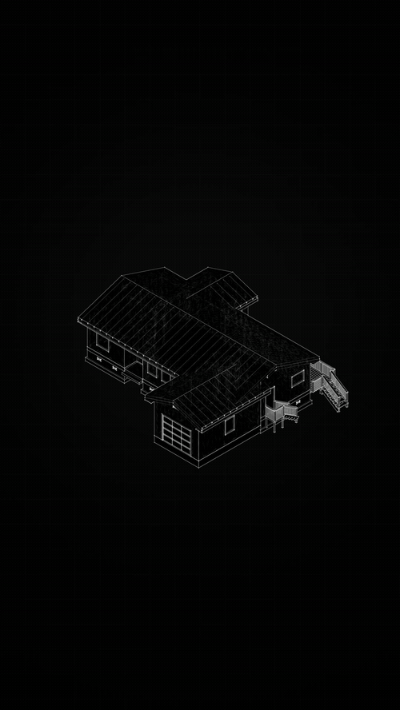
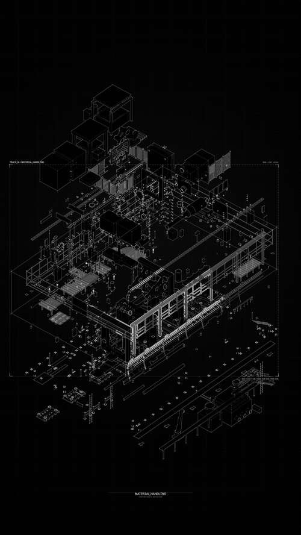
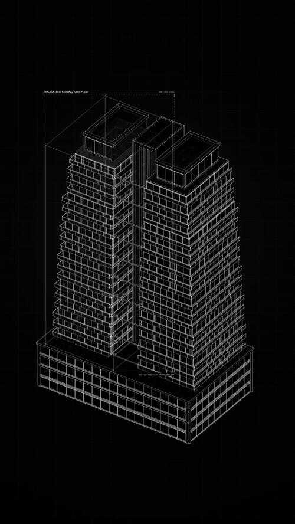
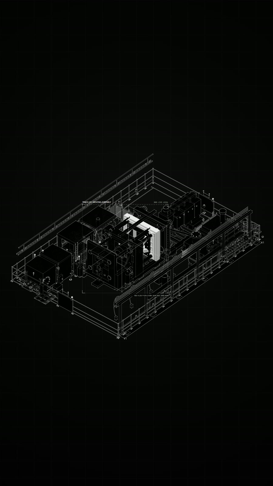

# Selected Model Breakdown outputs

[← Project](../README.md) · [Open the app](https://meshroom-breakdown-studio.limuwen9.chatgpt.site) · [Record the process](walkthrough.md)

Four supplied architectural sequences show the intended result: a complete assembly becomes legible through separation, component emphasis and a clear relationship to the whole. Click a card for the complete viewing copy.

<table><tr>
<td width="50%" align="center" valign="top"> <b>Structural hierarchy</b> Structure within an exploded assembly. <a href="https://muwentrili.github.io/creative-workflows/films/?project=model&amp;film=structure">Watch 11 s MP4</a></td>
<td width="50%" align="center" valign="top"> <b>Residential assembly</b> Detail with the full model as context. <a href="https://muwentrili.github.io/creative-workflows/films/?project=model&amp;film=residence">Watch 9.5 s MP4</a></td>
</tr></table>

 

<table><tr>
<td width="50%" align="center" valign="top"> <b>Building systems</b> Component emphasis and spatial relationships. <a href="https://muwentrili.github.io/creative-workflows/films/?project=model&amp;film=systems">Watch 11.5 s MP4</a></td>
<td width="50%" align="center" valign="top"> <b>Tower elements</b> Sequential explanation of levels and envelope. <a href="https://muwentrili.github.io/creative-workflows/films/?project=model&amp;film=tower">Watch 8 s MP4</a></td>
</tr></table>

## Read the detail

These are separately supplied still exports. Click to inspect them; they demonstrate the linework and hierarchy at a higher resolution than the browsing GIFs. They are selected outputs, not a before/after experiment.

<table><tr>
<td width="50%" align="center" valign="top"> <b>Detail study 1</b> <a href="media/detail-6.jpg">Inspect the still</a></td>
<td width="50%" align="center" valign="top"> <b>Detail study 2</b> <a href="media/detail-7.jpg">Inspect the still</a></td>
</tr></table>

 

<table><tr>
<td width="50%" align="center" valign="top"> <b>Detail study 3</b> <a href="media/detail-8.jpg">Inspect the still</a></td>
<td width="50%" align="center" valign="top"> <b>Detail study 4</b> <a href="media/detail-9.jpg">Inspect the still</a></td>
</tr></table>

## What remains to show

The input GLB and screen recording are not part of these supplied exports. A complete process demonstration should show import, part selection, one framing/timing correction, and an output check. [Walkthrough outline](walkthrough.md).

## Media provenance

| Viewing copy | Supplied source | Treatment |
| --- | --- | --- |
| structure.mp4 | meshroom-9_16-portrait (11).mp4 | Full 11 s sequence; 720 × 1280 H.264 / 30 fps |
| systems.mp4 | meshroom-9_16-portrait (16).mp4 | Full 11.5 s sequence; 720 × 1280 H.264 / 30 fps |
| tower.mp4 | meshroom-9_16-portrait (2).mp4 | Full 8 s sequence; 720 × 1280 H.264 / 30 fps |
| residence.mp4 | meshroom-9_16-portrait (6).mp4 | Full 9.5 s sequence; 720 × 1280 H.264 / 30 fps |
| detail-6.jpg to detail-9.jpg | Supplied still exports (6) to (9) | 900 px wide JPEG viewing copies |

Original videos and stills are 2160 × 3840. Large GIFs are 500 px wide at 8 fps and preserve the source composition. Each is a six-second excerpt: structure 5–11 s, residence 0–6 s, systems 5.5–11.5 s and tower 2–8 s. Compact overview GIFs remain separate. The complete MP4s preserve the supplied sequences. No generated imagery or replacement geometry was added. The supplied originals remain unchanged. The MP4/GIF viewing copies decode fully; this is a media-preparation check, not a new app export or usability test.

Media is **not covered by the MIT code license**. See [media rights](../MEDIA-RIGHTS.md). No source model is released by publishing its rendered output.
