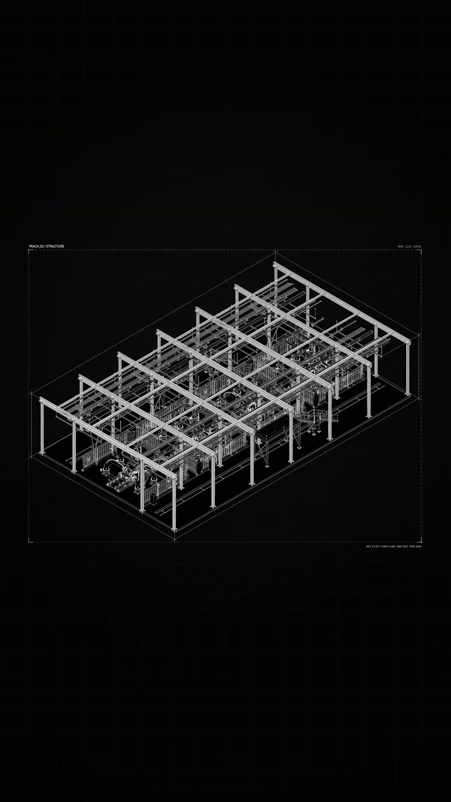
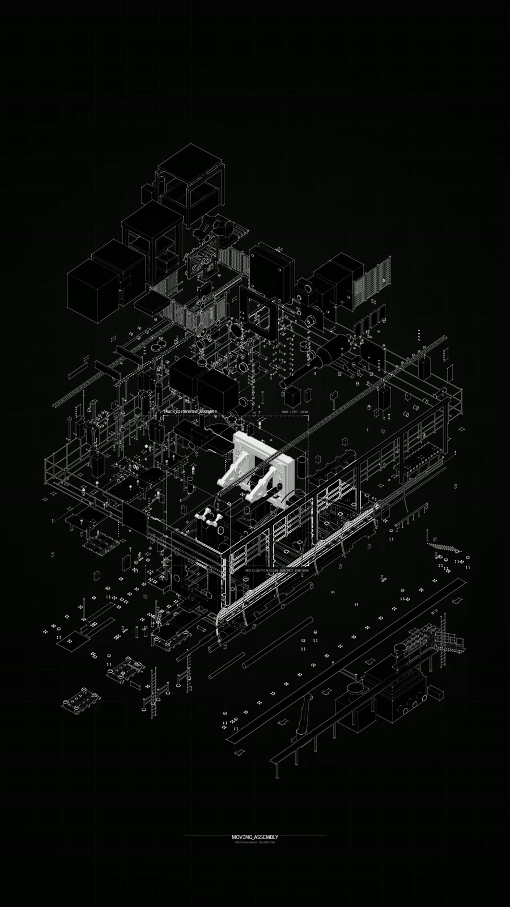
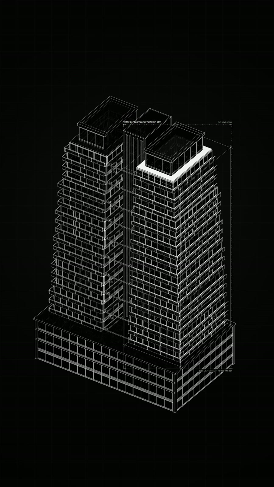
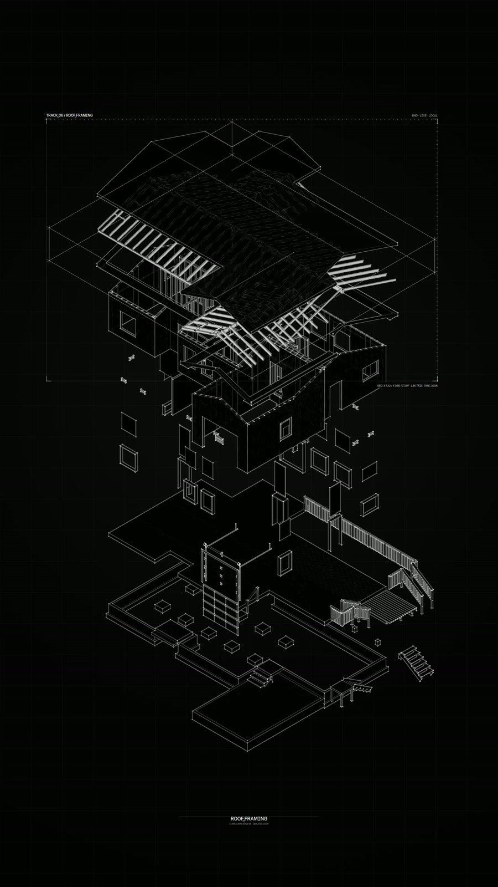

# Selected Model Breakdown outputs

[← Project](../README.md) · [Open the app](https://meshroom-breakdown-studio.limuwen9.chatgpt.site) · [Record the process](walkthrough.md)

Four supplied architectural sequences show the intended result: a complete assembly becomes legible through separation, component emphasis and a clear relationship to the whole. Click a card for the complete viewing copy.

<table><tr>
<td width="25%" align="center" valign="top"> <b>Structural hierarchy</b> <a href="media/structure.mp4">Watch 11 s MP4</a></td>
<td width="25%" align="center" valign="top"> <b>Building systems & focused detail</b> <a href="media/systems.mp4">Watch 11.5 s MP4</a></td>
<td width="25%" align="center" valign="top"> <b>Tower elements & envelope</b> <a href="media/tower.mp4">Watch 8 s MP4</a></td>
<td width="25%" align="center" valign="top"> <b>Residential assembly</b> <a href="media/residence.mp4">Watch 9.5 s MP4</a></td>
</tr></table>

## Read the detail

These are separately supplied still exports. Click to inspect them; they demonstrate the linework and hierarchy at a higher resolution than the browsing GIFs. They are selected outputs, not a before/after experiment.

<table><tr>
<td width="25%" align="center"> Detail study 1</td>
<td width="25%" align="center"> Detail study 2</td>
<td width="25%" align="center"> Detail study 3</td>
<td width="25%" align="center"> Detail study 4</td>
</tr></table>

## What remains to show

The input GLB and screen recording are not part of these supplied exports. A complete process demonstration should show import, part selection, one framing/timing correction, and an output check. [Walkthrough outline](walkthrough.md).

## Media provenance

| Viewing copy | Supplied source | Treatment |
| --- | --- | --- |
| structure.mp4 | meshroom-9_16-portrait (11).mp4 | Full 11 s sequence; 720 × 1280 H.264 / 30 fps |
| systems.mp4 | meshroom-9_16-portrait (16).mp4 | Full 11.5 s sequence; 720 × 1280 H.264 / 30 fps |
| tower.mp4 | meshroom-9_16-portrait (2).mp4 | Full 8 s sequence; 720 × 1280 H.264 / 30 fps |
| residence.mp4 | meshroom-9_16-portrait (6).mp4 | Full 9.5 s sequence; 720 × 1280 H.264 / 30 fps |
| detail-6.jpg to detail-9.jpg | Supplied still exports (6) to (9) | 900 px wide JPEG viewing copies |

Original videos and stills are 2160 × 3840. GIFs use reduced size/frame rate for README browsing. No generated imagery or replacement geometry was added. The supplied originals remain unchanged. The MP4/GIF viewing copies decode fully; this is a media-preparation check, not a new app export or usability test.

Media is **not covered by the MIT code license**. See [media rights](../MEDIA-RIGHTS.md). No source model is released by publishing its rendered output.
